<p align="center">
  
</p>

<p align="center">
  
  
  
</p>

# 📘 APE 4 - Fase 1, 2 y 3

Repositorio con los ejercicios en **Java** desarrollados en la **Actividad de Prácticas de Experimentación (APE 4)**, organizados en tres fases de dificultad progresiva.

---

## 📂 Organización del repositorio

```
APE-4-FASE1-2-3/
│
├── 📁 Fase 1
│   ├── Fase1_Ejercicio1.java
│   ├── Fase1_Ejercicio2.java
│   ├── Fase1_Ejercicio3.java
│   ├── Fase1_Ejercicio4.java
│   └── Fase1_Ejercicio5.java
│
├── 📁 Fase 2
│   ├── Fase2_Ejercicio1.java
│   ├── Fase2_Ejercicio2.java
│   ├── Fase2_Ejercicio3.java
│   ├── Fase2_Ejercicio4.java
│   ├── Fase2_Ejercicio5.java
│   ├── Fase2_Ejercicio6.java
│   ├── Fase2_Ejercicio7.java
│   └── Fase2_Ejercicio8.java
│
├── 📁 Fase 3
│   ├── Fase 3 Ejercicio1.java
│   ├── Fase 3 Ejercicio2.java
│   ├── Fase 3 Ejercicio3.java
│   ├── Fase 3 Ejercicio4.java
│   └── Fase 3 Ejercicio5.java
│
├── banner.svg
└── README.md
```

> Los archivos se encuentran actualmente en la raíz del repositorio; el esquema anterior los agrupa por fase para facilitar su lectura.

---

## 🧩 Resumen por fase

| Fase | Ejercicios | Archivos |
|:----:|:----------:|----------|
| **Fase 1** | 5 | `Fase1_Ejercicio1.java` → `Fase1_Ejercicio5.java` |
| **Fase 2** | 8 | `Fase2_Ejercicio1.java` → `Fase2_Ejercicio8.java` |
| **Fase 3** | 5 | `Fase 3 Ejercicio1.java` → `Fase 3 Ejercicio5.java` |
| **Total**  | **18** | |

---
